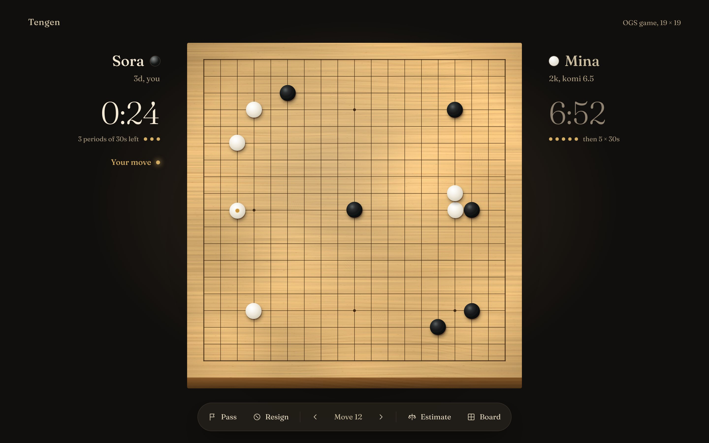
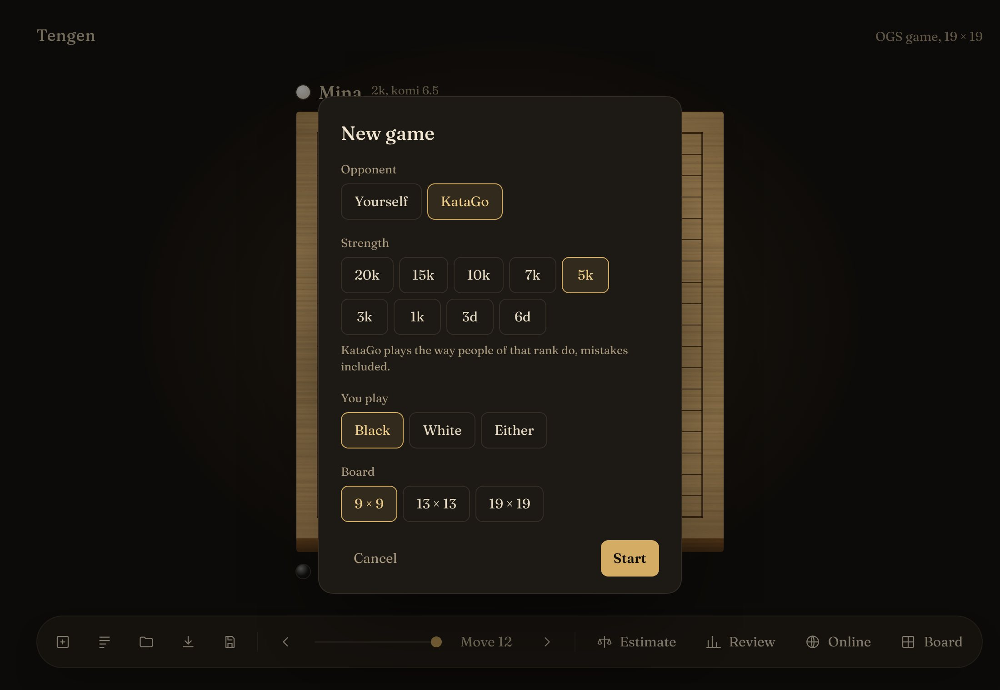
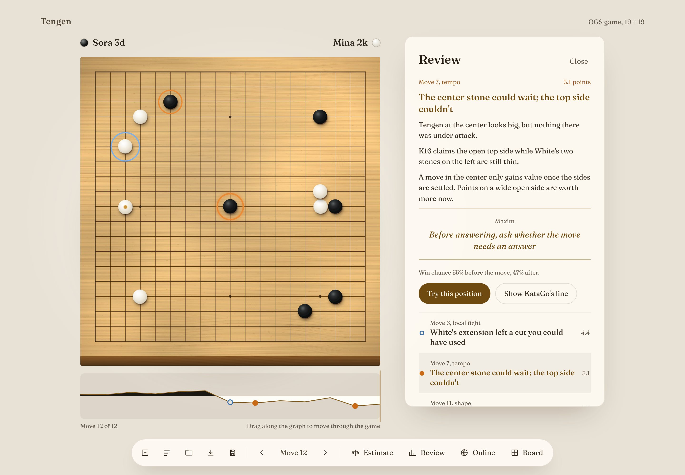

# Tengen

**A calm place to play and review Go on any server.**

Tengen (天元) is the center point of the board: every server meets in one place. Play on OGS, KGS, Pandanet or Fox, or against KataGo at the strength you choose, then review the game with KataGo and Claude on your own Mac.



## Download

Download **Tengen** from the [latest release](https://github.com/rrivera1849/tengen/releases/latest), open the `.dmg` and drag Tengen to Applications. It needs macOS 12 or later; score estimates, reviews and playing KataGo need a Mac with Apple Silicon.

Tengen isn't signed with an Apple developer certificate, so the first time you open it macOS says it can't check it. Open it once anyway:

1. Open Tengen, and close the warning macOS shows.
2. Open **System Settings → Privacy & Security**, scroll down, and choose **Open Anyway** next to Tengen.
3. Confirm with your password or Touch ID. From then on Tengen opens normally.

Tengen tells you, with a small link beside its name, when a newer release is out.

## What it does

### Play anywhere

| Server | Signing in | Automatch | Notes |
| --- | --- | --- | --- |
| [OGS](https://online-go.com) | In your browser; Tengen never sees your password | 9×9, 13×13, 19×19 | Blitz, rapid or live pace |
| [KGS](https://www.gokgs.com) | Name and password | 19×19, kyu players | Through KGS's official JSON API |
| [Pandanet](https://pandanet-igs.com) | Name and password | 19×19 | Canadian overtime supported |
| [Fox](https://www.foxwq.com) | Name and password | 9×9, 13×13, 19×19 | Experimental; see [Fox](#fox) |

Every server looks and plays the same: one click places a stone, clocks show byo-yomi periods as dots and warm up in your last seconds, and a soft tick counts down your final ten. If a server drops mid-game, "Reconnecting" appears over the board and Tengen reconnects on its own. While you wait for an opponent, Tengen shows a maxim from your past reviews to carry into the game.

### Play KataGo, offline



Choose **New game**, then **KataGo**, a strength from 20k to 6d, your color and a board size. KataGo plays with its human-style network, trained on people's games, so each move is the kind a player of that rank would make, mistakes included, rather than perfect play held back. It resigns once it's clearly lost, and when you both pass it counts the game and shows whose area is whose. The network is a one-time download of about 100 MB.

### Review with KataGo and Claude



Press **R** after any game. KataGo, running on your Mac, finds up to five of your mistakes and three of your opponent's, and circles them on the board: orange for yours, blue for theirs. The graph under the board shows who led, and dragging along it moves through the game. Each moment has KataGo's better line and, with a Claude API key, a plain-language lesson and a maxim for your next game.

**Try again** sets up each position before your mistakes so you can find the better move yourself, with three tries and a hint. KataGo scores every move you try: one within a point of its own choice counts, and one clearly better than the game's move gets a "closer".

KataGo decides what is true; Claude only explains it. Each lesson is written from facts Tengen has computed (the move, the better line, the points lost, which groups lived or died), and Tengen checks every coordinate and number before you see it. Saved SGF files keep the lessons as comments, and your maxims collect in **Your maxims**.

### Your games

Online games and games against KataGo save themselves when they end. **Your games** (⌘Y) lists them, newest first, with the ones you've reviewed marked. You can also open and save SGF files, and load any OGS game by its number or link.

### A board worth looking at

Kaya, shin-kaya, bamboo or ink on paper; shell-and-slate or flat stones; a day room and a night room that follow your Mac or stay as you choose; coordinates and stone sounds on or off. **Zen mode** (Z) leaves only the board and the clocks, and smaller windows move the players above and below the board. For fast games, **Click twice to place** shows a stone on the first click and places it on the second. All of it is under **Board**.

## Getting started

1. **Play online** (⌘L): choose a server and sign in once. Tengen keeps your sign-in in the macOS Keychain and signs in again on launch.
   - No account yet? OGS: [online-go.com](https://online-go.com). KGS: at [gokgs.com](https://www.gokgs.com), enter as a guest, then choose **Register**; KGS emails you a password. Pandanet: [register here](https://www.pandanet.co.jp/English/register/index.htm).
2. Pick a board size and pace, and choose **Find opponent**.
3. When both players pass, click dead stones to mark them (click again to bring them back), then **Accept score**. On OGS, check the stones OGS proposes; on Fox, Fox counts the game itself.
4. When the game ends, choose **Review this game**. The first review downloads KataGo, once.
5. For written lessons, add a Claude API key from [console.anthropic.com](https://console.anthropic.com) when the review offers it. Without a key, reviews still show the circled mistakes, the graph, Try again and KataGo's better lines.

## Privacy

Tengen has no server of its own. Your Mac connects straight to each Go server.

- **Passwords and sign-ins** are kept in the macOS Keychain and sent only to the server they belong to. OGS sign-in happens in your browser, so Tengen never sees that password.
- **KataGo** runs entirely on your Mac.
- **Claude** receives only board positions and KataGo's facts, never player names, and only when you've added your own API key.
- **The update check** asks GitHub for Tengen's list of releases, once per launch.
- **Diagnostics** are only collected on your Mac, and only leave it if you copy them yourself.

## Keys

| Key | Does |
| --- | --- |
| Click | Place a stone; while scoring, mark a group dead or alive |
| P | Pass |
| E | Show or hide the score estimate |
| R | Review the game |
| Z | Zen mode: only the board and the clocks |
| Esc | Drop a stone waiting for its second click, hide the estimate or a better line, leave a try or a lesson, close the review, leave zen mode |
| ← → | Step back or forward through the game |
| Home, End | Jump to the start or the end |
| ⌘Z | Take back the last move (against KataGo, your move and its answer) |
| ⌘N | New game |
| ⌘O | Open an SGF file |
| ⌘S | Save the game as SGF |
| ⌘D | Get a game from OGS |
| ⌘L | Play online |
| ⌘Y | Your games |

## Fox

Fox support is experimental. Fox has no public API and doesn't allow unofficial clients, so **an account used with Tengen could be restricted**. Tengen behaves like a person using the official client and never plays on its own, but use an account you can afford to lose.

Sign in with your Fox account name and password. Fox's apps let you sign in by phone, WeChat or Google without ever setting a password; if that's you, make an account with a password at Fox's [overseas sign-up page](https://account.foxwq.com/reg/foreign.html), which only needs an email.

Fox ends games by counting, not by marking dead stones. When both players pass, Tengen asks Fox to count; once your opponent agrees, Fox's AI judges the board, Tengen shows the stones it considers dead, and **Accept score** confirms. If your opponent asks to count, **Accept score** agrees.

## Reporting a problem

Choose **Play online**, then **Having trouble? Copy diagnostics** at the bottom, and paste the result into a [new issue](https://github.com/rrivera1849/tengen/issues/new). It holds recent connection events and messages, with your names on each server replaced by `<you>`; passwords and tokens are never recorded.

## Building from source

You need [Rust](https://rustup.rs), [Node.js](https://nodejs.org) 20 or later, and the Xcode Command Line Tools (`xcode-select --install`).

```sh
npm install
npm run tauri dev      # opens the app with live reload
npm run tauri build    # makes Tengen.app and a .dmg in target/release/bundle
```

`npm run dev` alone opens the interface in a browser with a sample game, for design work. Add `?live` for a live game with clocks, `?live&offline` to see it reconnecting, `?signedin&searching` for the search with a maxim, or `?update` for the update notice.

### OGS registration

Builds use Tengen's OGS app registration, whose client ID is in `tengen.toml`. It identifies the app, not a person: everyone signs in with their own account, and OGS public clients have no secret. To use a registration of your own (for a fork, say):

1. Sign in at online-go.com and open [online-go.com/oauth2/applications](https://online-go.com/oauth2/applications/).
2. Register a new application:
   - **Name:** what OGS should show people when they sign in
   - **Client type:** Public
   - **Authorization grant type:** Authorization code
   - **Redirect URIs:** `http://127.0.0.1:47613/oauth/callback` (exactly this)
3. Copy `tengen.local.example.toml` to `tengen.local.toml` (git ignores it) and paste the client ID in:

   ```toml
   ogs_client_id = "paste-the-client-id-here"
   ```

   Rebuild after changing it. Setting `TENGEN_OGS_CLIENT_ID=…` when building wins over both files.

### KataGo

KataGo publishes no Mac builds, so the **KataGo runtime** workflow (Actions tab, *Run workflow*) builds it with its Metal backend, adds a network, and publishes the `katago-runtime` release that Tengen downloads from, checking each file's SHA-256. The human-style network for playing KataGo comes from [KataGo's own release](https://github.com/lightvector/KataGo/releases/tag/v1.15.0), pinned by its SHA-256. To use a KataGo you already have instead:

```sh
TENGEN_KATAGO=/opt/homebrew/bin/katago \
TENGEN_KATAGO_MODEL=~/Downloads/kata1-b18c384nbt.bin.gz \
TENGEN_KATAGO_HUMAN_MODEL=~/Downloads/b18c384nbt-humanv0.bin.gz \
npm run tauri dev
```

### Tests

```sh
cargo test                                   # rules, SGF, server protocols, the app's logic
npm test                                     # the interface's Try again and clock logic
cargo test -p tengen-ogs -- --ignored        # also downloads a real game from OGS
TENGEN_KATAGO=… TENGEN_KATAGO_MODEL=… cargo test -p tengen-ai --test real_katago
TENGEN_KATAGO=… TENGEN_KATAGO_MODEL=… TENGEN_KATAGO_HUMAN_MODEL=… cargo test -p tengen-ai --test real_bot
```

The last two run against a real KataGo: analysis, estimates and reviews, then judging tried moves and playing as a person.

### Releasing

Set the new version in `package.json`, `Cargo.toml` and `src-tauri/tauri.conf.json`, add notes in `docs/releases/v<version>.md`, and push to main. The **Release** workflow notices the unreleased version, runs the tests, builds the app, tags `v<version>` and publishes the release with the `.dmg` attached.

### How it's built

```
src/                  Interface: TypeScript, drawn as SVG in the Mac web view
src-tauri/            The app shell: commands, sessions, the KataGo opponent, your games, diagnostics
crates/tengen-core/   Board rules, game records, SGF, and the server interfaces
crates/tengen-ogs/    OGS: REST, browser sign-in (auth.rs) and live play (realtime.rs)
crates/tengen-kgs/    KGS: the JSON API over HTTP long polling
crates/tengen-igs/    Pandanet: the IGS text protocol over TCP
crates/tengen-fox/    Fox: its binary protocol over TCP (see PROTOCOL.md)
crates/tengen-ai/     KataGo bridge, estimates, reviews, judging, the human-style player, Claude client, maxims
```

Every server plugs into the interfaces in `tengen-core` (`ServerAdapter` for records, `LiveClient` and `LiveEvent` for live play), so the interface never knows which server a game came from. Each adapter keeps its protocol in a `protocol.rs` with no networking, tested line by line.

## Thanks

- [KataGo](https://github.com/lightvector/KataGo) by David Wu, for the analysis and the human-style network.
- [foxwq-web](https://github.com/foxwq-web/foxwq-web.github.io), whose open browser client documented Fox's protocol ([`PROTOCOL.md`](crates/tengen-fox/PROTOCOL.md)).
- [Fraunces](https://fonts.google.com/specimen/Fraunces), the typeface.

## License

MIT
